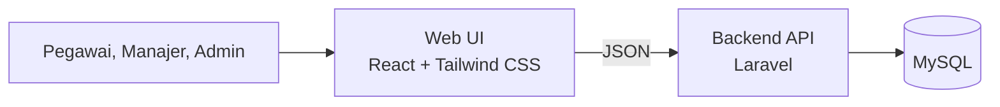

<div align="center">

# WorkBalance

> Sistem pendukung keputusan berbasis web untuk memantau beban kerja dan kondisi kerja pegawai (SDG 8).


</div>

WorkBalance mengumpulkan data kondisi kerja yang dalam skenario proyek ini tersebar di spreadsheet, formulir, dokumen, dan komunikasi internal: tugas, jam kerja, survei pegawai, laporan masalah, insiden keselamatan, dan data pelatihan. Semuanya disimpan dalam satu basis data dengan akses berdasarkan peran.

Dari data itu sistem menghitung Workload Risk untuk setiap pegawai dan Decent Work Score untuk setiap departemen pada setiap periode, lalu menampilkannya sebagai dashboard, rekomendasi tindakan, dan laporan. Keputusan membagi tugas atau memperbaiki kondisi kerja tetap ada di tangan manajer.

Proyek ini dikerjakan oleh Kelompok A-A untuk mata kuliah PPL (SI4804).

## Daftar isi

- [Latar belakang](#latar-belakang)
- [Status dan batasan](#status-dan-batasan)
- [Fitur](#fitur)
- [Peran pengguna](#peran-pengguna)
- [Cara perhitungan](#cara-perhitungan)
- [Teknologi](#teknologi)
- [Arsitektur dan data](#arsitektur-dan-data)
- [Memulai](#memulai)
- [Product backlog](#product-backlog)
- [Endpoint API](#endpoint-api)
- [Tim](#tim)
- [Desain dan dokumen](#desain-dan-dokumen)
- [Referensi](#referensi)

## Latar belakang

SDG 8 menargetkan pekerjaan yang layak dan produktif (Target 8.5) serta perlindungan hak pekerja dan lingkungan kerja yang aman (Target 8.8). Menurut ILO (2012), waktu kerja yang layak, keseimbangan kehidupan kerja, dan keselamatan termasuk elemen penting dari pekerjaan layak. WHO dan ILO (2021) melaporkan bahwa bekerja 55 jam per minggu atau lebih berkaitan dengan kenaikan risiko stroke sebesar 35% dan kematian akibat penyakit jantung iskemik sebesar 17%. PP Nomor 35 Tahun 2021 menetapkan waktu kerja normal 40 jam per minggu, dengan batas lembur 4 jam per hari dan 18 jam per minggu.

BPS menerbitkan indikator pekerjaan layak dari Sakernas, tetapi angkanya mewakili tingkat nasional dan provinsi, tidak per organisasi. Di dalam organisasi, data tugas, jam kerja, lembur, cuti, survei, dan keselamatan bisa tersebar di banyak media. Manajer lalu harus menggabungkannya secara manual untuk menilai beban kerja, sehingga beban berlebih terlambat diketahui dan tindak lanjutnya tidak tercatat. Skenario ini adalah asumsi tim; tidak ada survei lapangan di baliknya.

Proyek ini punya tiga tujuan khusus:

1. Mencatat data kondisi pekerjaan secara terstruktur dalam satu sistem.
2. Menghitung Workload Risk per pegawai dan Decent Work Score per departemen setiap periode, dengan hasil yang sama dengan perhitungan manual pada kasus uji.
3. Menyajikan hasilnya lewat dashboard, rekomendasi tindakan, dan laporan periodik agar manajer bisa menentukan prioritas tindak lanjut.

## Status dan batasan

WorkBalance adalah purwarupa akademik yang diuji dengan data sintetis. Kontribusinya terbatas pada pemantauan kondisi kerja yang mendukung Target 8.5 dan 8.8. Proyek ini tidak mengklaim dampak terukur terhadap capaian SDG 8.

- Belum ditujukan untuk lingkungan produksi.
- Tidak ada integrasi dengan payroll, absensi biometrik, BPJS, atau API pihak ketiga.
- Workload Risk dan Decent Work Score dirancang oleh tim dan belum divalidasi secara empiris. Keduanya bukan standar resmi ILO, BPS, atau pemerintah, dan tidak dipakai untuk menilai kepatuhan terhadap peraturan.
- Hasil analisis tidak dipakai untuk diagnosis kesehatan, penilaian kinerja pegawai, atau keputusan kepegawaian otomatis.
- Hanya sebagian aspek decent work yang tercakup: hak pekerja, waktu kerja, keselamatan, dan suara pekerja. Perlindungan sosial dan penciptaan lapangan kerja berada di luar cakupan.

Karena datanya sintetis dan indikatornya belum divalidasi, angka yang tampil di aplikasi memperagakan logika sistem dan tidak menggambarkan kondisi pekerja yang sebenarnya.

## Fitur

Pengelolaan data. Autentikasi dan pengaturan hak akses berdasarkan peran; data pegawai, departemen, jabatan, dan jenis kepegawaian; tugas beserta estimasi waktu, prioritas, dan tenggat; penugasan; pencatatan work log; survei kondisi kerja; laporan permasalahan kerja; pencatatan insiden keselamatan; katalog dan keikutsertaan pelatihan; keterampilan dan kompetensi pegawai.

Analitik. Workload Risk dihitung mingguan per pegawai dan diringkas per bulan. Decent Work Score dihitung bulanan per departemen. Rumusnya ada di bagian [Cara perhitungan](#cara-perhitungan).

Penyajian. Dashboard manajer berisi ringkasan indikator, beban kerja, dan permasalahan tim. Tren kondisi kerja bisa difilter dan dibandingkan menurut periode dan departemen. Rekomendasi tindakan muncul dari indikator dan risiko yang terdeteksi, dan laporan bisa dibuat serta diunduh per periode atau departemen.

Pengajuan lembur, pengajuan cuti, pengelolaan kompensasi, dan pemantauan tindak lanjut tercantum di daftar kebutuhan (FR-09, FR-10, FR-11, FR-21) tetapi belum punya PBI. Sampai FR-09 tersedia, lembur dihitung dari jam aktual di work log yang melebihi jam kerja normal.

## Peran pengguna

Akses diatur dengan Role-Based Access Control.

| Peran   | Tugas                                                                                   | Hak akses                                                                                                                                    |
| ------- | --------------------------------------------------------------------------------------- | -------------------------------------------------------------------------------------------------------------------------------------------- |
| Pegawai | Mengerjakan tugas, mencatat aktivitas dan kondisi kerja yang dialami                    | Melihat data pribadi; menambah dan mengubah work log, lembur, cuti, survei, dan laporan masalah                                              |
| Manajer | Memantau kondisi tim, mengelola pekerjaan, menindaklanjuti hasil analisis               | Melihat, menambah, mengubah, dan menghapus data tim, tugas, penugasan, lembur, permasalahan, dan pelatihan; mengakses dashboard dan analisis |
| Admin   | Mengelola konfigurasi sistem, struktur organisasi, data master, pengguna, dan hak akses | Akses penuh sesuai kewenangan sistem                                                                                                         |

Hasil analisis individual hanya terlihat oleh pegawai yang bersangkutan dan manajer timnya. Hasil survei ditampilkan kepada manajer dalam bentuk agregat. Decent Work Score dihitung per departemen, jadi tidak ada skor individual yang dibentuk dari data survei.

## Cara perhitungan

### Workload Risk

Dihitung per pegawai setiap minggu, lalu diringkas per bulan. Skor akhir adalah rata-rata empat indikator berbobot sama. Tiap indikator berskala 0 sampai 100, dengan interpolasi linear di antara batas bawah dan batas atas.

| Indikator            | Dihitung dari                                                                                                                                                                      | Skor 0                | Skor 100                                                                          |
| -------------------- | ---------------------------------------------------------------------------------------------------------------------------------------------------------------------------------- | --------------------- | --------------------------------------------------------------------------------- |
| Waktu kerja mingguan | Total jam di work log dalam satu minggu                                                                                                                                            | 40 jam atau kurang    | 55 jam atau lebih                                                                 |
| Lembur               | Proporsi hari kerja dengan jam aktual di atas jam normal harian (8 jam untuk lima hari kerja, 7 jam untuk enam hari kerja). Memakai data lembur yang disetujui jika FR-09 tersedia | Tidak ada hari lembur | Semua hari kerja lembur, atau lembur lebih dari 4 jam sehari atau 18 jam seminggu |
| Beban tugas          | Total estimasi jam tugas aktif dibagi kapasitas tersedia (40 jam dikurangi cuti)                                                                                                   | Rasio 1,0 atau kurang | Rasio 1,5 atau lebih                                                              |
| Tekanan tenggat      | Proporsi tugas aktif yang jatuh tempo dalam 7 hari atau sudah lewat tenggat                                                                                                        | 0%                    | 100%                                                                              |

Kategori: Rendah (di bawah 40), Sedang (40 sampai 69), Tinggi (70 atau lebih). Pegawai yang bekerja 55 jam per minggu atau lebih, atau yang lemburnya melewati batas PP 35/2021, otomatis masuk kategori Tinggi walaupun skornya di bawah 70.

Batas pada indikator beban tugas dan tekanan tenggat, serta ambang kategori, adalah nilai awal dari tim. Nilai-nilai itu belum dikalibrasi dan bisa diubah lewat konfigurasi model.

### Decent Work Score

Dihitung per departemen setiap bulan. Skor adalah rata-rata enam dimensi dengan bobot awal sama, masing-masing bernilai 0 sampai 100.

| Dimensi                              | Cara menghitung                                                                                                                                | Sumber data                           |
| ------------------------------------ | ---------------------------------------------------------------------------------------------------------------------------------------------- | ------------------------------------- |
| Waktu kerja dan beban                | 100 dikurangi rata-rata Workload Risk pegawai di departemen                                                                                    | Hasil Workload Risk                   |
| Keseimbangan kehidupan dan pekerjaan | Rata-rata jawaban survei terkait keseimbangan (skala 1 sampai 5), dikonversi dengan (nilai - 1) / 4 x 100                                      | Respons survei                        |
| Kelengkapan kompensasi               | Persentase pegawai yang punya data kompensasi pada periode berjalan                                                                            | Data kompensasi                       |
| Keselamatan kerja                    | Rata-rata dari (100 dikurangi 50 untuk tiap insiden berat, minimum 0) dan persentase insiden yang sudah ditangani (100 jika tidak ada insiden) | Insiden keselamatan                   |
| Suara pekerja                        | Rata-rata persentase laporan masalah yang sudah ditangani dan persentase pegawai yang mengisi survei                                           | Permasalahan kerja dan respons survei |
| Pengembangan kompetensi              | Rata-rata persentase pegawai yang mengikuti minimal satu pelatihan dan persentase kompetensi yang mencapai target                              | Pelatihan dan kompetensi              |

Kategori: Baik (75 atau lebih), Perlu Perhatian (50 sampai 74), Prioritas Tindakan (di bawah 50).

Tiga dimensi punya catatan. Kelengkapan kompensasi hanya memeriksa ketersediaan data dan tidak menilai kecukupan upah. Suara pekerja hanya mencakup kanal internal tanpa representasi serikat, sehingga tidak sama dengan dialog sosial menurut ILO. Pengembangan kompetensi bukan salah satu dari sepuluh elemen ILO; dimensi ini ditambahkan oleh tim. Bobot semua dimensi bisa diubah lewat konfigurasi model, dan setiap perubahan tercatat di jejak audit.

### Rekomendasi tindakan

Rekomendasi dihasilkan oleh aturan berbasis ambang, tanpa machine learning. Pegawai berkategori Tinggi memicu saran untuk mengevaluasi atau meredistribusi tugasnya. Dimensi dengan nilai terendah di suatu departemen memicu saran tindak lanjut pada dimensi itu. Kompetensi di bawah target memicu saran pelatihan. Manajer yang memutuskan apakah rekomendasi dijalankan.

## Teknologi

| Bagian                    | Teknologi                                                                          |
| ------------------------- | ---------------------------------------------------------------------------------- |
| Frontend                  | React                                                                              |
| UI                        | Tailwind CSS                                                                       |
| Visualisasi data          | Recharts                                                                           |
| Backend                   | Laravel (API, logika bisnis, validasi, pengelolaan data)                           |
| Database                  | MySQL                                                                              |
| Autentikasi dan otorisasi | Laravel Sanctum dengan role dan permission                                         |
| Pengujian                 | Automated test untuk fungsi utama backend, ditambah uji fungsional pada alur utama |
| Format data               | JSON antara frontend dan backend                                                   |
| Version control           | Git                                                                                |

Pengembangan dan pengujian berjalan di komputer lokal dengan browser modern. Kebutuhan nonfungsional yang dipakai sebagai acuan adalah keamanan, privasi data, kinerja, keandalan, usability, maintainability, scalability, dan auditability.

## Arsitektur dan data



Arsitektur digambar dengan ArchiMate dalam tiga lapisan. Business layer berisi tiga aktor yang memakai layanan WorkBalance. Application layer berisi Authentication & RBAC, Workload Risk & Decent Work Score, Dashboard & Recommendation, Web UI, Backend API, dan data sistem. Technology layer berisi lingkungan pengembangan lokal, database service, dan MySQL.

ERD terdiri atas 24 entitas dalam lima kelompok.

| Kelompok                        | Entitas                                                                                       |
| ------------------------------- | --------------------------------------------------------------------------------------------- |
| Pengguna dan organisasi         | `USER_ACCOUNT`, `EMPLOYEE`, `DEPARTMENT`, `POSITION`, `EMPLOYMENT_TYPE`                       |
| Tugas dan aktivitas kerja       | `TASK`, `TASK_ASSIGNMENT`, `WORK_LOG`, `OVERTIME`, `LEAVE_REQUEST`, `COMPENSATION`            |
| Kesejahteraan dan kondisi kerja | `WORK_SURVEY`, `SURVEY_RESPONSE`, `WORKPLACE_ISSUE`, `SAFETY_INCIDENT`                        |
| Pelatihan dan kompetensi        | `TRAINING`, `TRAINING_PARTICIPATION`, `COMPETENCY`, `EMPLOYEE_COMPETENCY`                     |
| Analisis dan tindak lanjut      | `WORKLOAD_RISK`, `DECENT_WORK_SCORE`, `RECOMMENDATION`, `IMPROVEMENT_ACTION`, `ACTION_UPDATE` |

`EMPLOYEE` menjadi entitas utama yang menghubungkan data pegawai dengan data pekerjaan dan hasil analisis.

## Memulai

Prasyarat: PHP dan Composer, Node.js dan npm, MySQL, Git.

<!-- Sesuaikan nama folder dengan struktur repo yang sebenarnya. -->

```bash
git clone <url-repo>
cd workbalance

# backend
cd backend
composer install
cp .env.example .env
php artisan key:generate
# isi koneksi MySQL di .env (variabel DB_*)
php artisan migrate --seed
php artisan serve

# frontend (terminal lain)
cd frontend
npm install
npm run dev
```

Menjalankan pengujian backend:

```bash
php artisan test
```

## Product backlog

Backlog ditulis sebagai user story dengan estimasi dalam hari kerja. Pengembangan memakai Scrum (Beck dkk., 2001; Schwaber & Sutherland, 2020) dalam tiga sprint, dan setiap sprint ditutup dengan Sprint Review dan Sprint Retrospective.

Sprint 0 (minggu ke-6) menyiapkan repositori kerja, skema database, autentikasi dan role-based access, serta backlog Sprint 1 yang sudah dirapikan. Pekerjaan ini tidak punya PBI.

### Sprint 1 (minggu ke-7 sampai 10): data organisasi, aktivitas kerja, dan indikator awal

Total estimasi 28 hari.

| ID     | User story                                                                                                                                                                                   | FR           | Hari | PIC     |
| ------ | -------------------------------------------------------------------------------------------------------------------------------------------------------------------------------------------- | ------------ | ---- | ------- |
| PBI-01 | Sebagai admin, saya ingin mengelola data pegawai agar informasi pegawai tersimpan secara akurat dan konsisten.                                                                               | FR-02, FR-05 | 4    | Malfino |
| PBI-02 | Sebagai admin, saya ingin mengelola data departemen agar struktur organisasi dapat digunakan untuk pengelompokan pegawai.                                                                    | FR-03        | 3    | Malfino |
| PBI-03 | Sebagai manajer, saya ingin mengelola tugas beserta estimasi waktu, prioritas, dan tenggat agar pekerjaan dapat direncanakan secara terstruktur.                                             | FR-06        | 3    | Lola    |
| PBI-04 | Sebagai manajer, saya ingin mengelola penugasan pegawai beserta tenggatnya agar distribusi pekerjaan terkelola dengan jelas dan teratur.                                                     | FR-07        | 1    | Lola    |
| PBI-05 | Sebagai admin atau manajer, saya ingin mengelola katalog pelatihan agar program pengembangan kompetensi terdokumentasi.                                                                      | FR-15        | 3    | Sabila  |
| PBI-06 | Sebagai admin atau manajer, saya ingin mengelola pendaftaran dan keikutsertaan pegawai dalam pelatihan agar program pengembangan kompetensi dapat dipantau.                                  | FR-15        | 1    | Sabila  |
| PBI-07 | Sebagai pegawai, saya ingin mengisi survei kondisi kerja agar organisasi memperoleh informasi mengenai pengalaman kerja dan keseimbangan kehidupan pribadi.                                  | FR-12        | 3    | Nabila  |
| PBI-08 | Sebagai pegawai, saya ingin melaporkan permasalahan di tempat kerja dan memantau status penanganannya agar laporan dapat ditindaklanjuti.                                                    | FR-13        | 3    | Nabila  |
| PBI-09 | Sebagai pegawai, saya ingin mencatat waktu aktual dan aktivitas pekerjaan agar estimasi dan realisasi pekerjaan dapat dibandingkan.                                                          | FR-08        | 1    | Lola    |
| PBI-10 | Sebagai manajer, saya ingin melihat ringkasan indikator kondisi kerja, beban kerja, dan permasalahan tim agar dapat menentukan prioritas pengelolaan tim.                                    | FR-19        | 3    | Ide     |
| PBI-11 | Sebagai manajer, saya ingin mengidentifikasi potensi beban kerja yang tidak proporsional berdasarkan data penugasan, jam aktual, lembur, dan tenggat agar risiko dapat ditangani lebih awal. | FR-17        | 3    | Devin   |

PBI-11 bergantung pada PBI-09 karena Workload Risk memerlukan jam kerja aktual dari work log.

### Sprint 2 (minggu ke-11 sampai 14): kompetensi, keselamatan, analitik, dan laporan

Total estimasi 20 hari.

| ID     | User story                                                                                                                                                        | FR    | Hari | PIC     |
| ------ | ----------------------------------------------------------------------------------------------------------------------------------------------------------------- | ----- | ---- | ------- |
| PBI-12 | Sebagai admin, saya ingin mengelola data jabatan agar posisi pegawai tercatat sesuai struktur organisasi.                                                         | FR-04 | 1    | Malfino |
| PBI-13 | Sebagai pegawai, saya ingin mencatat keterampilan dan tingkat kompetensi agar perkembangan kemampuan dapat dipantau.                                              | FR-16 | 3    | Sabila  |
| PBI-14 | Sebagai pengelola, saya ingin mencatat insiden keselamatan beserta status penanganannya agar dapat digunakan untuk evaluasi keselamatan dan kesehatan kerja (K3). | FR-14 | 3    | Nabila  |
| PBI-15 | Sebagai manajer, saya ingin menyaring dan membandingkan tren kondisi pekerjaan berdasarkan periode dan departemen agar perubahan kondisi dapat dianalisis.        | FR-19 | 3    | Ide     |
| PBI-16 | Sebagai manajer, saya ingin membuat dan mengunduh laporan kondisi kerja berdasarkan periode dan departemen agar kondisi kerja dapat dievaluasi secara berkala.    | FR-22 | 3    | Ide     |
| PBI-17 | Sebagai manajer, saya ingin melihat Decent Work Score berdasarkan periode agar kondisi pekerjaan dapat ditinjau secara agregat.                                   | FR-18 | 4    | Devin   |
| PBI-18 | Sebagai manajer, saya ingin menerima rekomendasi tindakan berdasarkan indikator dan risiko yang teridentifikasi agar penanganan kondisi kerja terarah.            | FR-20 | 3    | Devin   |

Kebutuhan FR-09 (lembur), FR-10 (cuti), FR-11 (kompensasi), dan FR-21 (pemantauan tindak lanjut) belum masuk backlog. FR-01 (autentikasi dan RBAC) dikerjakan di Sprint 0.

## Endpoint API

Semua endpoint berada di bawah `/api/v1`. Resource pengelolaan data memakai `POST` untuk menambah, `GET` untuk melihat, `PUT` untuk mengubah, dan `DELETE` untuk menghapus.

| PBI    | Endpoint                       | Metode                                      |
| ------ | ------------------------------ | ------------------------------------------- |
| PBI-01 | `/employees`                   | POST, GET, PUT, DELETE                      |
| PBI-02 | `/departments`                 | POST, GET, PUT, DELETE                      |
| PBI-03 | `/tasks`                       | POST, GET, PUT, DELETE                      |
| PBI-04 | `/task-assignments`            | POST, GET, PUT, DELETE                      |
| PBI-05 | `/trainings`                   | POST, GET, PUT, DELETE                      |
| PBI-06 | `/training-participations`     | POST, GET, PUT, DELETE                      |
| PBI-07 | `/surveys`                     | POST, GET, PUT, DELETE                      |
| PBI-08 | `/workplace-issues`            | POST, GET, PUT, DELETE                      |
| PBI-09 | `/work-logs`                   | POST, GET, PUT, DELETE                      |
| PBI-10 | `/dashboard/manager`           | GET                                         |
| PBI-11 | `/analytics/workload-risk`     | POST (hitung ulang), GET                    |
| PBI-12 | `/positions`                   | POST, GET, PUT, DELETE                      |
| PBI-13 | `/employee-competencies`       | POST, GET, PUT, DELETE                      |
| PBI-14 | `/safety-incidents`            | POST, GET, PUT, DELETE                      |
| PBI-15 | `/analytics/trends`            | GET                                         |
| PBI-16 | `/reports/work-condition`      | POST (buat laporan), GET (lihat atau unduh) |
| PBI-17 | `/analytics/decent-work-score` | POST (hitung), GET                          |
| PBI-18 | `/recommendations`             | GET                                         |

## Tim

| Nama                         | Peran                                                                    | PBI                    |
| ---------------------------- | ------------------------------------------------------------------------ | ---------------------- |
| Devin Octavian               | Project Manager dan Full Stack Developer, fitur analitik dan rekomendasi | PBI-11, PBI-17, PBI-18 |
| Ide Adventine Kawan Sudirman | Full Stack Developer, fitur dashboard dan laporan                        | PBI-10, PBI-15, PBI-16 |
| Lola Larasati BR Pasaribu    | Full Stack Developer, fitur tugas dan aktivitas kerja                    | PBI-03, PBI-04, PBI-09 |
| Malfino Dima Putra           | Full Stack Developer, fitur data pegawai dan organisasi                  | PBI-01, PBI-02, PBI-12 |
| Nabila Nur Cahyati           | Full Stack Developer, fitur kesejahteraan dan kondisi kerja              | PBI-07, PBI-08, PBI-14 |
| Sabila Martasyah             | Full Stack Developer, fitur pelatihan dan kompetensi                     | PBI-05, PBI-06, PBI-13 |

Setiap anggota mengerjakan modulnya dari frontend sampai database, lalu bersama-sama mengintegrasikan dan menguji sistem.

## Desain dan dokumen

- [Mockup di Figma](https://www.figma.com/design/15batg8EFT8DnA1zxrknv5/Untitled?node-id=0-1&t=cratz4PWHM0JLZpI-1)
- [Prototype di Figma](https://www.figma.com/proto/15batg8EFT8DnA1zxrknv5/Untitled?node-id=1-2&p=f&t=iM0QWS7w0QdB36yM-1&scaling=min-zoom&content-scaling=fixed&page-id=0%3A1)

Proposal pengembangan produk (8 Oktober 2026) memuat use case description, arsitektur ArchiMate, dan ERD secara lengkap.

## Referensi

- Badan Pusat Statistik (2025). [Indikator pekerjaan layak di Indonesia 2024](https://www.bps.go.id/id/publication/2025/04/28/1ecc9dec1ef7a591babf5962/indikator-pekerjaan-layak-di-indonesia-2024.html).
- International Labour Organization (2012). [Decent work indicators: Concepts and definitions](https://capacity4dev.europa.eu/media/15613/download/27f2f048-6c80-48b7-9b51-df051932abaa_en).
- Pega, F., dkk. (2021). [Global, regional, and national burdens of ischemic heart disease and stroke attributable to exposure to long working hours for 194 countries, 2000-2016](https://doi.org/10.1016/j.envint.2021.106595). Environment International, 106595.
- World Health Organization & International Labour Organization (2021). [Long working hours increasing deaths from heart disease and stroke](https://www.who.int/news/item/17-05-2021-long-working-hours-increasing-deaths-from-heart-disease-and-stroke-who-ilo).
- Pemerintah Republik Indonesia (2021). Peraturan Pemerintah Nomor 35 Tahun 2021 tentang Perjanjian Kerja Waktu Tertentu, Alih Daya, Waktu Kerja dan Waktu Istirahat, dan Pemutusan Hubungan Kerja.
- United Nations DESA. [Goal 8: Promote sustained, inclusive and sustainable economic growth, full and productive employment and decent work for all](https://sdgs.un.org/goals/goal8).
- International Labour Organization. [Goal 8: Promote inclusive and sustainable economic growth, employment and decent work for all](https://www.ilo.org/global/topics/dw4sd/theme-by-sdg-targets/WCMS_556964/lang--en/index.htm).
- Schwaber, K. & Sutherland, J. (2020). [The Scrum Guide](https://scrumguides.org/scrum-guide.html).
